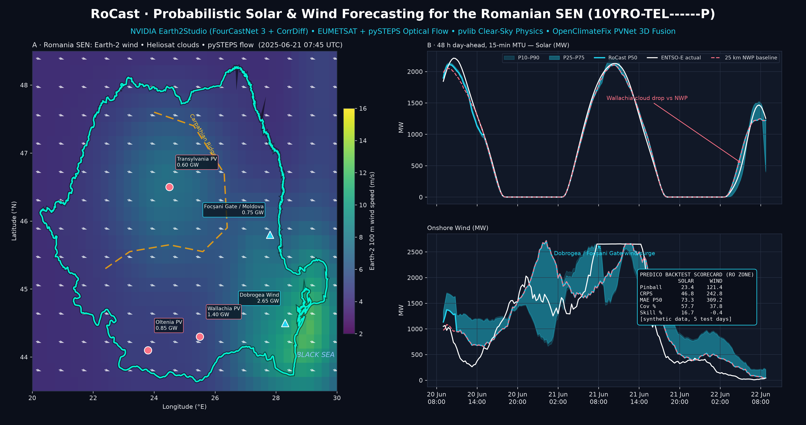

# RoCast: Probabilistic Solar & Wind Forecasting for the Romanian Grid (SEN)

[](https://github.com/iulio/Ro-cast/actions/workflows/ci.yml)


[](LICENSE)


RoCast forecasts solar and onshore wind for Romania’s bidding zone (`10YRO-TEL------P`) in 15-minute intervals. It combines SEVIRI cloud motion, NVIDIA Earth-2 ensembles, clear-sky solar physics, and PyTorch quantile regression for intraday balancing and day-ahead planning.



*Left: ERA5 wind and cloud-cover contours, pySTEPS advection vectors, and the SE Wind Corridor polygon. Right: 48 hours of rolling two-hour hindcasts evaluated on held-out ENTSO-E generation using archived ERA5 weather.*

## Verified out-of-sample benchmark

The Predico-style scorecard covers **192 quarter-hour samples** from **2025-06-20 08:00 UTC** to **2025-06-22 08:00 UTC**, end exclusive. Model fitting and calibration ended at 05:45 UTC on June 20, before the first forecast issue time. The chart uses a lightweight calibrated archive model and a single held-out window. The PVNet fusion backtest has a separate evaluation pipeline.

| Metric | Solar | Onshore wind | Benchmark or interpretation |
| :--- | ---: | ---: | :--- |
| **Skill** | **+45.4%** | **+31.4%** | Solar CRPS vs. day-ahead ERA5. Wind P50 MAE vs. two-hour ERA5 persistence. |
| **P10–P90 coverage** | **84.1% daylight** / 89.6% all hours | **89.6%** | Observations within the nominal 80% interval |
| P50 MAE | 76.5 MW | 254.6 MW | Mean absolute error of the median forecast |
| Pinball loss | 31.0 MW | 80.4 MW | Mean across the five quantile losses |
| CRPS | 61.6 MW | 167.6 MW | Continuous ranked probability score |

Skill is `100 × (1 − forecast error / baseline error)`. Solar uses the MAE of the plotted deterministic baseline as its baseline CRPS. That baseline uses prior-day ERA5 irradiance, scaled on calibration data.

## Why Romania is hard to forecast

- **Distributed PV changes visible demand.** ANRE recorded 3.53 GW of installed prosumer capacity at the end of January 2026. When households and businesses consume their own solar output, the grid sees the effect through demand. RoCast ingests ENTSO-E A75 generation and A65 load and derives residual demand by subtracting reported solar and onshore wind from total load. [ANRE prosumer report](https://anre.ro/wp-content/uploads/2026/03/Situatie-prosumatori_ianuarie_2026.pdf)
- **Coastal and terrain-driven wind ramps matter.** Transelectrica’s summer 2026 study lists 3.14 GW of licensed wind capacity. RoCast represents Dobrogea and the Focșani Gate / southern Moldova corridor as separate hubs to capture differences in Black Sea exposure and Carpathian terrain. [Transelectrica 2026 summer study](https://www.transelectrica.ro/documents/10179/92180/Memoriu%2Bstudiu%2Bvara%2B2026_public%2Bfinal.pdf/18854b51-0b5c-44b0-8a8f-28cf6eb85afa)
- **Weather and market intervals differ.** A quarter-hour power forecast needs to represent cloud banks moving across Wallachia and wind ramps between coarse weather model outputs. The satellite branch estimates short-horizon cloud motion and the atmospheric branch provides longer-horizon context.

## Multi-scale architecture

```text
0-6 h      Native EUMETSAT SEVIRI scans -> Heliosat cloud index
            -> Lucas-Kanade optical flow -> semi-Lagrangian advection --+
                                                                      |
Physics    pvlib Ineichen clear-sky GHI -> elevation and night mask --+
                                                                      |
6-48 h     Earth2Studio FourCastNet 3 -> Romanian ensemble features ---+
            Open-Meteo hub weather -> physical power baseline         |
                                                                      v
Telemetry  ENTSO-E A75 generation + A65 load -> GRU ----------> PVNetRomaniaFusion
                                                                      |
                                         P10 / P25 / P50 / P75 / P90 <-+
```

The PyTorch model combines a 3D satellite encoder, a spatial Earth-2 encoder, recent telemetry and exogenous features. It enforces ordered quantiles and zero solar power at night. The optical-flow branch has a NumPy fallback. Offline runs use synthetic weather and telemetry. Live mode accepts local SEVIRI files and can run FourCastNet 3 through Earth2Studio with the optional backend installed. See [PLAN.md](PLAN.md) for tensor shapes and cutoff rules.

## Polygon forecasting

`RomaniaPolygonEngine` uses Shapely and a bundled geoBoundaries outline to clip longitude/latitude rings, GeoJSON, or WKT to Romania (`ROU`). A vectorized mask selects weather-grid cells inside the clipped area. If capacity is omitted, the model scales national installed capacity from ENTSO-E A68 by the intersected area and falls back to configured capacity if ENTSO-E is unavailable. The polygon CLI currently uses clear-sky solar physics and synthetic cloud and wind inputs.

## Installation & Quickstart

```bash
git clone https://github.com/iulio/Ro-cast.git
cd Ro-cast
python -m venv .venv
source .venv/bin/activate
python -m pip install -e ".[dev]"
cp .env.example .env
```

On Windows PowerShell, activate with `.\.venv\Scripts\Activate.ps1` and use `Copy-Item .env.example .env`. Copy the example on first setup and keep your existing `.env` on later runs. Install `.[nowcast]` for pySTEPS, `.[satellite]` for native SEVIRI ingestion, and `.[earth2]` for Earth2Studio.

## Data Sources & API Credentials

| Source | Credential | When required |
| :--- | :--- | :--- |
| Open-Meteo | None for the public endpoints RoCast uses | The live backtest and an uncached ERA5 download require internet access. |
| ENTSO-E Transparency Platform | `ROCAST_ENTSOE_API_KEY` | Required for the live backtest. Optional for polygon capacity lookup and hero generation when a cached ENTSO-E CSV is available or an ERA5-derived benchmark is sufficient. |
| EUMETSAT Data Store | `ROCAST_EUMETSAT_KEY` and `ROCAST_EUMETSAT_SECRET` | Required for authenticated downloads with EUMDAC. RoCast accepts local scans through `--seviri-dir`. |
| NVIDIA NGC / Earth-2 NIM | `NGC_API_KEY` for NVIDIA tools, `ROCAST_NGC_API_KEY` for the RoCast NIM client | Optional. Used when provisioning Earth-2 NIM or calling an authenticated NIM endpoint. The `--earth2 earth2studio` CLI option selects the separate FourCastNet 3 backend. |

### ENTSO-E Transparency Platform

1. Register on the [ENTSO-E Transparency Platform](https://transparency.entsoe.eu/) and verify your account email.
2. Email `transparency@entsoe.eu` with the subject `RESTful API access` and include your registered email address in the message.
3. After approval, sign in, open **My Account**, generate a security token, and save it as `ROCAST_ENTSOE_API_KEY` in your local `.env`. [ENTSO-E token instructions](https://transparencyplatform.zendesk.com/hc/en-us/articles/12845911031188-How-to-get-security-token)

### EUMETSAT Data Store

1. Register or sign in with your EUMETSAT EO Portal account.
2. Open the **API Key Management** page from your user profile and generate or retrieve your **Consumer Key** and **Consumer Secret**. [EUMETSAT API Key Management](https://api.eumetsat.int/api-key/)
3. Store them as `ROCAST_EUMETSAT_KEY` and `ROCAST_EUMETSAT_SECRET` if you use a local download script. Pass the values to EUMDAC as its consumer credentials. Once the native SEVIRI scans are on disk, point RoCast at that directory with `--seviri-dir`. [EUMETSAT Data Store guide](https://user.eumetsat.int/resources/user-guides/frequently-asked-questions-for-data-store)

### NVIDIA NGC

Sign in to NGC, open **Account Settings → API Keys**, and generate a personal key with access to the Earth-2 NIM service you plan to use. Export `NGC_API_KEY` for NVIDIA tooling. If you call the RoCast NIM client against an authenticated endpoint, also set `ROCAST_NGC_API_KEY` in your local `.env`. [Earth-2 NIM prerequisites](https://docs.nvidia.com/nim/earth-2/fourcastnet/latest/prerequisites.html)

### Offline runs and cache paths

After installation, the synthetic backtest runs offline with every key blank. It generates weather and telemetry locally. Polygon forecasts can also run offline with `--capacity-mw` and the bundled boundary. The archive chart can regenerate offline once its weather inputs are cached. Reproducing the ENTSO-E scorecard offline also requires its cached generation CSV. An uncached archive fetch or a live backtest needs a network connection.

`ROCAST_DATA_DIR` and `ROCAST_ASSETS_DIR` in [`.env.example`](.env.example) are suggested paths for external download scripts. The current hero generator uses repository-relative `data/` and `assets/`. Keep real tokens in your local, ignored `.env`.

## Usage

### National 48-hour backtest and export

```bash
python -m rocast.cli backtest --mode synthetic --epochs 1 --days 8 --n-test-windows 2 --train-stride 12 --output-dir outputs
```

The command writes `outputs/predico_submission.csv`, per-target submissions, and `outputs/backtest_metrics.json`. Submission rows contain a UTC timestamp and five quantiles. Select the primary submission with `--target solar_mw` or `--target wind_onshore_mw`. The CLI also supports `backtest --mode live` with ENTSO-E and Open-Meteo data.

### Dobrogea wind polygon

```bash
python -m rocast.cli polygon-forecast --coords '[[27.1,43.9],[29.4,43.9],[29.4,46.1],[27.1,46.1],[27.1,43.9]]' --resource wind --hours 48 --capacity-mw 100 --output outputs/dobrogea_wind.csv
```

Here, 100 MW is an example portfolio capacity. Pass `--geojson` with a file path to use a saved polygon.

### Python API

```python
from rocast.cli import run_backtest

report = run_backtest(
    mode="synthetic", epochs=1, days=8, n_test_windows=2,
    train_stride=12, output_dir="outputs",
)
print(report["targets"]["solar_mw"]["mae_p50_mw"])
```

### Reproduce the chart

```bash
python scripts/generate_linkedin_hero.py
```

The generator uses Open-Meteo ERA5 archives and ENTSO-E generation for June 15–22, 2025. It caches inputs under `data/`. A cached generation CSV or an ENTSO-E key reproduces the telemetry-backed scorecard. If neither is available, the generator uses an explicitly labeled ERA5-derived power benchmark.

## Repository layout

```text
rocast/              Forecast models, physics, ingestion, geometry, and CLI
scripts/             Hero chart generator and archive hindcast
tests/               Unit and end-to-end tests
assets/              Published hero image
data/                Local archive inputs used by the chart generator
.github/workflows/   GitHub Actions tests and distribution builds
```

## CI and distributions

Run `ruff check rocast tests scripts` and `python -m pytest -q` locally. GitHub Actions runs lint, tests, and the offline CLI smoke test on Python 3.11–3.13. After the matrix passes, it builds the wheel and source distribution, exercises the installed wheel from outside the checkout, and uploads both as the `rocast-distributions` artifact.

## Roadmap

- Blend DWD ICON-EU, GFS, and ECMWF IFS using fixed-lead verification.
- Evaluate battery dispatch optimization with state-of-charge constraints and negative-price curtailment on the OPCOM day-ahead market.
- Build a Predico competition submission adapter and add verification over multiple weather regimes.

See [CONTRIBUTING.md](CONTRIBUTING.md) for the development workflow.

## License and acknowledgments

RoCast is released under the [MIT License](LICENSE) and maintained by [Iulian Amăricăi (`iulio`)](https://github.com/iulio) / Global Consult.

The project builds on [OpenClimateFix PVNet](https://github.com/openclimatefix/pvnet), [pySTEPS](https://github.com/pySTEPS/pysteps), [pvlib](https://github.com/pvlib/pvlib-python), [NVIDIA Earth2Studio](https://github.com/NVIDIA/earth2studio), and [entsoe-py](https://github.com/EnergieID/entsoe-py). The archive chart uses Copernicus ERA5 via [Open-Meteo](https://open-meteo.com/en/docs/historical-weather-api), generation from [ENTSO-E Transparency](https://transparency.entsoe.eu/), and a [geoBoundaries](https://www.geoboundaries.org/) outline.
