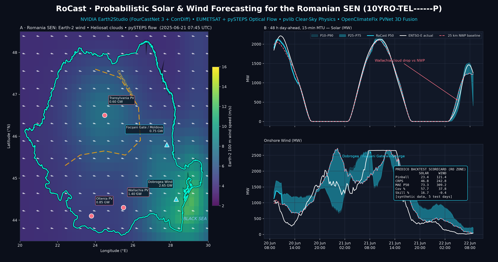

# RoCast 🇷🇴⚡

[](https://www.python.org/) [](LICENSE) [](#testing) [](https://transparency.entsoe.eu/)

**RoCast** is a multi-scale **probabilistic Solar (PV) and Wind power forecasting engine** for the Romanian National Power System (SEN, ENTSO-E bidding zone `10YRO-TEL------P`), built to compete on **Predico**, **EnergyBench** and **OPCOM** day-ahead / intraday balancing markets.

- 15-minute MTU resolution, **6 h nowcast**, **48 h day-ahead** horizon
- **P10–P90 quantile** forecasts (strictly monotone), Predico-compatible CSV export
- Three physics + ML branches: **pySTEPS/pvlib** satellite nowcasting, **NVIDIA Earth-2** ensembles, and a **PVNet-style fusion network**
- No generative LLMs in the loop — deterministic NWP + optical flow + a compact neural net



## Contents

- [Architecture](#architecture)
- [Install](#install)
- [Quickstart](#quickstart)
- [CLI reference](#cli-reference)
- [Outputs](#outputs)
- [Configuration](#configuration)
- [Benchmarks](#benchmarks)
- [Repository layout](#repository-layout)
- [Testing](#testing)
- [Live mode](#live-mode)
- [FAQ](#faq)
- [Contributing](#contributing)
- [License](#license)

## Architecture

```
                         ┌──────────────────────────┐
 EUMETSAT SEVIRI ───────► │ Branch 1: pySTEPS + pvlib │──┐
 (VIS/IR/WV, 15 min)      │ Heliosat cloud index      │  │
                         │ LK optical flow + advection│  │   ┌─────────────────────────────┐
                         │ 24 steps = 6 h nowcast    │  ├──►│                             │
                         └──────────────────────────┘  │   │  PVNetRomaniaFusion         │──► P10..P90 (MW)
                         ┌──────────────────────────┐  │   │  sat encoder + Earth-2 enc. │    Predico CSV
 Open-Meteo / ENTSO-E ──► │ Branch 2: NVIDIA Earth-2  │──┤   │  + GRU telemetry + exo MLP  │    metrics JSON
 (NWP hub weather)       │ FourCastNet 3 ensemble    │  │   │  monotone quantile head     │
                         │ mean + spread, Romania    │  │   │  pinball loss, capacity     │
                         └──────────────────────────┘  │   │  clamp, solar night mask    │
                         ┌──────────────────────────┐  │   │                             │
 ENTSO-E A75/A65 ───────► │ Branch 3: telemetry      │──┘   └─────────────────────────────┘
 (solar/wind/load, 15m)  │ 96-step history GRU      │
                         └──────────────────────────┘
```

**Leakage safety:** for a forecast cutoff `t0`, the satellite branch only uses scans at or before `t0 − 15 min`, and the Earth-2 branch is initialised at the last 6 h boundary ≤ `t0`. The backtest is walk-forward: train on all windows strictly before the first test cutoff, evaluate on `n` non-overlapping 48 h test windows at the end of the series.

### Romanian prosumer split

| Source | ENTSO-E doc | What it captures |
|---|---|---|
| Utility solar, onshore wind | **A75** | metered generation (`solar_mw`, `wind_onshore_mw`) |
| Total load | **A65** | includes ~4 GW behind-the-meter prosumer PV self-consumption |

RoCast models both and derives `net_load_ex_renewables_mw = total_load_mw − solar_mw − wind_onshore_mw`.

### Hubs

Five representative hubs: **Dobrogea** (wind, 2650 MW), **Moldova/Focșani** (wind, 750 MW), **Wallachia** (solar, 1400 MW), **Oltenia** (solar, 850 MW), **Transylvania** (solar, 600 MW). National capacities: 2850 MW solar, 3550 MW wind.

## Install

```bash
python -m venv .venv && .venv/Scripts/activate        # Windows
# python -m venv .venv && source .venv/bin/activate    # Linux/macOS
pip install -e ".[dev,nowcast]"
```

Optional extras: `earth2` (Earth-2 studio), `satellite` (satpy/pyresample for real SEVIRI files), `foundation` (Chronos). Or with [uv](https://docs.astral.sh/uv/): `uv venv && uv pip install -e ".[dev,nowcast]"`.

For live mode, copy `.env.example` to `.env` and fill in your ENTSO-E / NGC / EUMETSAT credentials (`.env` is gitignored).

## Quickstart

```bash
# offline, synthetic world — no keys needed, runs in a few minutes
python -m rocast.cli backtest --mode synthetic --output-dir outputs

# tests
pytest -v

# hero figure
python scripts/generate_linkedin_hero.py

# version
python -m rocast.cli --version
```

## CLI reference

```
rocast backtest [--mode {synthetic,live}] [--epochs N] [--days N]
                [--n-test-windows N] [--train-stride N] [--seed N]
                [--target {solar_mw,wind_onshore_mw}] [--output-dir DIR]
                [--seviri-dir DIR] [--earth2 {none,earth2studio}]
rocast --version
rocast --quiet ...        # warnings/errors only on stderr
```

| Flag | Default | Meaning |
|---|---|---|
| `--mode` | `synthetic` | `synthetic` = offline demo world; `live` = ENTSO-E + Open-Meteo |
| `--epochs` | `15` | training epochs per target (cosine LR schedule) |
| `--days` | `14` | length of the series in days |
| `--n-test-windows` | `3` | walk-forward test windows (48 h each) |
| `--train-stride` | `6` | stride between training windows (15 min steps) |
| `--target` | `solar_mw` | which target goes into `predico_submission.csv` |
| `--output-dir` | `outputs` | where artifacts are written |
| `--seviri-dir` | — | live: directory of SEVIRI native files |
| `--earth2` | `none` | live: `earth2studio` to enable the Earth-2 branch |

## Outputs

Written to `--output-dir`:

- `predico_submission.csv` — columns exactly `datetime,q10,q25,q50,q75,q90`, ISO-8601 UTC (`...Z`), for the `--target` target
- `predico_submission_<target>.csv` — per-target submissions
- `backtest_forecast_<target>.csv` — last test window: actual, NWP baseline, and all quantiles
- `backtest_metrics.json` — full metrics report (see below)

## Configuration

All settings live in `rocast/config.py` (`RoCastSettings`, pydantic-settings) and can be overridden via environment variables with the `ROCAST_` prefix or a `.env` file. Key fields:

| Setting | Default | Meaning |
|---|---|---|
| `bidding_zone` | `10YRO-TEL------P` | ENTSO-E bidding zone |
| `mtu_minutes` | `15` | market time unit |
| `t_past` / `t_future` | `96` / `192` | history steps / forecast horizon (24 h / 48 h) |
| `t_sat` / `t_nowcast` | `4` / `24` | satellite frames / nowcast steps (6 h) |
| `satellite_lag_minutes` | `15` | minimum age of the newest usable scan |
| `quantiles` | `(0.10, 0.25, 0.50, 0.75, 0.90)` | output quantiles |
| `d_model` | `32` | fusion model width |
| `solar_capacity_mw` / `wind_capacity_mw` | `2850` / `3550` | capacity ceilings used for clamping |

## Benchmarks

__BENCHMARK_TABLE__

## Repository layout

```
rocast/
  config.py                     # pydantic-settings configuration
  cli.py                        # CLI + walk-forward backtest pipeline
  physics/clearsky_advection.py # pvlib clear-sky + pySTEPS LK nowcasting
  earth2/nvidia_weather_engine.py  # Earth-2 / FourCastNet 3 branch
  ingestion/grid_weather_sampler.py # ENTSO-E / Open-Meteo / synthetic data
  models/pvnet_romania.py       # PVNetRomaniaFusion + calibrated pinball loss
  backtest/predico_evaluator.py # Predico metrics + submission export
tests/                          # pytest suite
scripts/generate_linkedin_hero.py
assets/rocast_linkedin_hero.png
docs/original-spec.md           # original build spec
```

See [PLAN.md](PLAN.md) for the detailed architecture (tensor shapes, cutoff math) and [docs/original-spec.md](docs/original-spec.md) for the original specification.

## Testing

```bash
pytest -v                 # 12 tests, no keys needed (synthetic mode)
ruff check rocast tests scripts
ruff format --check rocast tests scripts
python -m build           # sdist + wheel
```

CI runs the same on Python 3.11 and 3.13 (`.github/workflows/ci.yml`).

## Live mode

`--mode live` pulls ENTSO-E transparency data (A75 generation, A65 load) and Open-Meteo hub weather for the last `--days` days. Pass `--seviri-dir` (directory of SEVIRI native files, timestamps parsed from filenames) and `--earth2 earth2studio` to activate the satellite and Earth-2 branches; otherwise they fall back to clear-sky / climatological inputs with a warning. Live mode requires API keys in `.env` and is **not** exercised by the offline test suite.

## FAQ

**Why quantiles instead of a point forecast?** Balancing markets (Predico, OPCOM) pay for probabilistic bids; P10–P90 lets the trader price imbalance risk.

**Does it beat the NWP baseline?** On the synthetic offline world, see [Benchmarks](#benchmarks). On real data, run `--mode live` — that is the only honest evaluation.

**Why synthetic mode at all?** It makes the whole pipeline (ingestion → nowcast → fusion → metrics → Predico CSV) testable in CI without API keys or satellite files.

**Is pySTEPS required?** No — there is an automatic NumPy fallback (`nowcast_backend` in the metrics JSON reports `pysteps-LK` or `numpy-fallback`). Install `.[nowcast]` for the real LK advection.

**GPU needed?** No — the model is small (d_model=32) and trains on CPU in minutes.

## Contributing

See [CONTRIBUTING.md](CONTRIBUTING.md). Changes are tracked in [CHANGELOG.md](CHANGELOG.md). Pre-commit hooks run ruff; CI runs pytest on two Python versions.

## License

[MIT](LICENSE) — Copyright (c) 2026 RoCast contributors.
